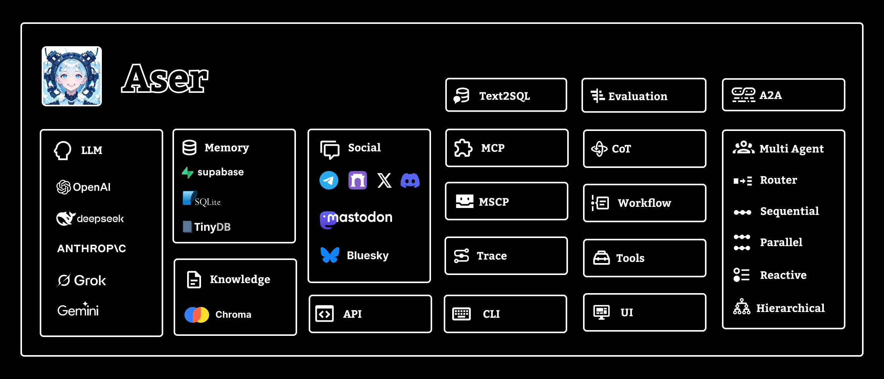

# Aser

Aser是一个极简、模块化且多功能的AI代理框架。您只需几行代码即可组装一个代理。



[Twitter](https://x.com/Web3Rickey) | [文档](https://docs.ame.network/aser/overview) | [获取支持](https://t.me/hello_rickey) | [English](./README.md)

## 安装

**从pypi安装:**

```bash
pip install aser
```

**或克隆仓库:**

```bash
git clone https://github.com/AmeNetwork/aser.git
cd aser
pip install -r requirements.txt
```

## 设置环境变量

请参考`.env.example`文件，创建您自己的`.env`文件。您不需要配置所有环境变量，只需选择您使用的那些。

**.env文件示例:**

```bash
#MODEL
MODEL_BASE_URL=<您的模型基础URL>
MODEL_KEY=<您的模型密钥>
```

## 支持的 LLM 提供商

Aser 兼容任何 OpenAI 兼容 API。通过内置 `providers` 模块可快速配置：

| 提供商 | 模型 | 上下文长度 |
|--------|------|-----------|
| OpenAI | gpt-4o, gpt-4.1-mini, … | 最高 128K |
| [MiniMax](https://platform.minimax.io) | MiniMax-M2.7, MiniMax-M2.7-highspeed, MiniMax-M2.5, MiniMax-M2.5-highspeed | **204K** |
| 任意 OpenAI 兼容 API | 设置 `MODEL_BASE_URL` + `MODEL_KEY` | 取决于模型 |

### 使用 MiniMax

```bash
export MINIMAX_API_KEY=your_api_key_here
```

```python
from aser.agent import Agent
from aser.providers import MINIMAX, MINIMAX_MODELS

agent = Agent(
    name="minimax_agent",
    model=MINIMAX_MODELS["standard"],   # "MiniMax-M2.7"
    model_config=MINIMAX,
)
response = agent.chat("你好，请介绍一下 MiniMax。")
print(response)
```

完整示例参见 [examples/agent_minimax.py](./examples/agent_minimax.py)。

## 使用

```python
#基础
from aser.agent import Agent
agent=Agent(name="aser代理",model="gpt-4.1-mini")
response=agent.chat("什么是比特币？")
print(response)
```

```python
# 完整配置
aser = Agent(
    name="aser",
    model="gpt-4o-mini",
    tools=[web3bio, exa],
    knowledge=knowledge,
    memory=memory,
    chat2web3=[connector],
    mcp=[price],
    trace=trace
)
```

## 快速开始

如果您克隆了项目源代码，在运行示例前，请在根目录运行`pip install -e .`，这允许Python从本地源代码找到并导入aser模块。如果您通过`pip install aser`安装，可以直接运行示例。

### 初级:

- [Aser代理](./examples/agent.py): 您的第一个AI代理
- [模型配置](./examples/agent_model.py): 自定义LLM配置
- [MiniMax](./examples/agent_minimax.py): 使用 MiniMax M2.7/M2.5 模型（204K 上下文）
- [角色](./examples/agent_character.py): 构建具有角色的代理
- [记忆](./examples/agent_memory.py): 构建具有记忆存储的代理
- [RAG](./examples/agent_knowledge.py): 构建具有知识检索的代理
- [工具](./examples/agent_tools.py): 构建具有工具的代理
- [工具包](./examples/agent_toolkits.py): 使用内置工具包
- [追踪](./examples/agent_trace.py): 构建具有追踪功能的代理
- [API](./examples/agent_api.py): 构建具有API服务器的代理
- [CLI](./examples/agent_cli.py): 使用CLI与代理交互
- [Discord](./examples/agent_discord.py): 构建具有Discord客户端的代理
- [Telegram](./examples/agent_telegram.py): 构建具有Telegram客户端的代理
- [Farcaster](./examples/agent_farcaster.py): 构建具有Farcaster客户端的代理

### 中级:

- [思维链](./examples/agent_cot.py): 思维链
- [MCP](./examples/agent_mcp.py): 模型上下文协议
- [Text2SQL](./examples/agent_text2sql.py): 构建具有Text2SQL功能的代理
- [工作流](./examples/agent_workflow.py): 自定义代理工作流
- [评估](./examples/agent_evaluation.py): 评估AI代理
- [路由多代理](./examples/router_multi_agent.py): 多个代理基于路由分配任务
- [顺序多代理](./examples/sequential_multi_agent.py): 多个代理顺序工作
- [并行多代理](./examples/parallel_multi_agent.py): 多个代理同时工作
- [响应式多代理](./examples/reactive_multi_agent.py): 多个代理响应变化
- [分层多代理](./examples/hierarchical_multi_agent.py): 多个代理在不同层级工作
- [代理UI](https://github.com/AmeNetwork/ame-ui): 通过UI与代理交互

### 高级:

- [MSCP](./examples/agent_mcp.py): 模型智能合约协议
- [A2Aser](./examples/a2a_server.py): 集成Google Agent2Agent (A2A)协议
- [A2A客户端](./examples/a2a_client.py): 代理到代理客户端
- [自编码工具](./examples/self_coding_tool.py): 代理可以自编码构建工具

### 实验:
- [ERC8004服务器代理](./examples/a2a_erc8004_server.py): 服务器代理提供服务并执行任务
- [ERC8004身份](./examples/agent_mscp_erc8004.py): 使用MSCP ERC8004连接器进行身份注册


## 许可证
Aser是开源的，采用MIT许可证授权。


